  

Self-taught programmer and product builder.

| | |
|---|---|
| Last 52 weeks | **{{TOTAL}}** contributions |
| Busiest week | **{{WEEK_VALUE}}**, {{WEEK_SPAN}} |
| Busiest day | **{{DAY_VALUE}}** on {{DAY_DATE}} |
| Last 31 days | **{{LAST31}}** contributions |

How to read the mountains

One mountain range for the last 52 weeks, oldest on the left. Each peak is one week of contributions, all on
one scale. Quiet weeks stay flat and become the lake. The balloons, cloud and animals are just there for fun.
Numbers come from GitHub's public contribution calendar ({{FIRST}} to {{LAST}}) and refresh every day.

